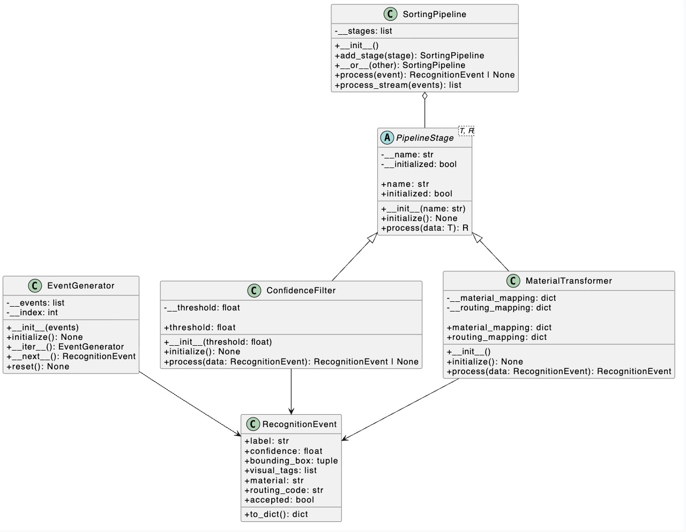

# Hometask 2 - Real-Time Data Processing

## AI-Powered Waste Sorting & Recycling Assistant

This project implements an event-driven stream processing framework for
real-time waste recognition data from automated conveyor belt optical sorters.

The pipeline receives recognition events, filters low-confidence predictions,
transforms recognized objects into material categories, and assigns conveyor
routing codes.

## Processing Pipeline

Recognition Event
        |
        v
Event Generator
        |
        v
Confidence Filter
        |
        v
Material Transformer
        |
        v
Processed Event
        |
        v
Material + Routing Code

Example:

PET_BOTTLE
confidence = 0.94
        |
        v
Confidence Filter
        |
        v
PET
        |
        v
ROUTE_PET

## OOP Concepts Demonstrated

### 1. Abstract Base Classes

`PipelineStage` is an abstract base class using Python's
`abc.ABC` and `@abstractmethod`.

Every concrete processing stage implements:

    process(data)

### 2. Inheritance and Polymorphism

`ConfidenceFilter` and `MaterialTransformer` inherit from
`PipelineStage`.

Both expose the same `process()` interface while performing
different operations.

### 3. Operator Overloading

`SortingPipeline` overloads the `|` operator using `__or__()`.

This allows pipeline composition:

    pipeline = ConfidenceFilter(0.5) | MaterialTransformer()

### 4. Iterators

`EventGenerator` implements:

    __iter__()
    __next__()

This allows recognition events to be consumed one at a time,
simulating a real-time stream.

## Main Classes

### RecognitionEvent

Represents one recognition event containing:

- detected label
- confidence score
- bounding box
- visual tags
- material category
- routing code

### PipelineStage

Abstract interface for processing stages.

### ConfidenceFilter

Rejects recognition events whose confidence is below the configured threshold.

### MaterialTransformer

Transforms object recognition labels into material categories and routing codes.

Example:

    PET_BOTTLE -> PET -> ROUTE_PET

### SortingPipeline

Composes processing stages and executes them sequentially.

### EventGenerator

Provides recognition events one at a time through the iterator protocol.

## Class Diagram



## Example Material Routing

| Recognition Label | Material | Routing Code |
|---|---|---|
| PET_BOTTLE | PET | ROUTE_PET |
| HDPE_BOTTLE | HDPE | ROUTE_HDPE |
| ALUMINUM_CAN | ALUMINUM | ROUTE_ALUMINUM |
| GLASS_BOTTLE | GLASS | ROUTE_GLASS |
| PAPER | PAPER | ROUTE_PAPER |

## Running the Demo

```bash
python demo_streaming_pipeline.py