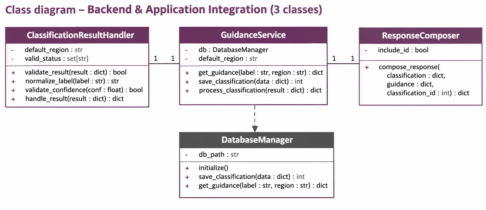

# AI-assisted Waste Sorting & Recycling Assistant

## 1. Team Overview

### Project

The project aims to support waste sorting and recycling by using an AI-based image classification system to identify waste items and provide appropriate disposal guidance for the Dortmund region.

### Team Members and Responsibilities

| Team Member | Subsystem | Main Responsibility |
|---|---|---|
|  Kanika Sehgal  | Web Interface | Develops the user interface for image upload, classification results, and disposal guidance. |
| Azam Rahmani    | ML / Image Classification | Develops and integrates the image classification model for identifying waste items. |
| Sai Teja Chinni | Backend & Application Integration | Connects the classifier, data management, and guidance components and prepares structured responses for the frontend. |
| Ha Le Thu       | Data Management & AI Guidance | Manages waste-related data and database operations and provides AI-assisted disposal guidance. |


## 2. System Design

### Overall System Architecture
    ```text
                         ┌─────────────────────┐
                         │    Web Interface    │
                         └──────────┬──────────┘
                                    │
                                    ▼
                         ┌─────────────────────┐
                         │    Flask Backend    │
                         └──────────┬──────────┘
                                    │
                                    ▼
                         ┌─────────────────────┐
                         │  ML Classification  │
                         └──────────┬──────────┘
                                    │
                                    ▼
                  ┌─────────────────────────────────┐
                  │ Backend & Application Integration│
                  └───────────────┬─────────────────┘
                                  │
                                  ▼
                  ┌─────────────────────────────────┐
                  │ Data Management & AI Guidance   │
                  └───────────────┬─────────────────┘
                                  │
                    ┌─────────────┴─────────────┐
                    ▼                           ▼
              ┌───────────┐              ┌────────────┐
              │  Database │              │ OpenAI API │
              └───────────┘              └────────────┘
    ```

## Subsystem 1 - Frontend Interface (Kanika Sehgal)

#### Implemented Classes

| Class | Responsibility |
|---|---|
| `ClassificationResultHandler` | Validates and normalizes the classification result received from the ML classifier. It handles the waste label, confidence, status, and region. |
| `GuidanceService` | Retrieves disposal guidance using the classified waste label and region and saves the classification result through the existing `DatabaseManager`. |
| `ResponseComposer` | Combines the classification result and disposal guidance into a structured API response for the frontend. |

#### UML Class Diagram


## Subsystem 2 - Backend & Application Integration (Sai Teja Chinni)

The Backend & Application Integration subsystem connects the waste classification result with the data management and guidance components and prepares a consistent response for the frontend.

#### Implemented Classes

| Class | Responsibility |
|---|---|
| `ClassificationResultHandler` | Validates and normalizes the classification result received from the ML classifier. It handles the waste label, confidence, status, and region. |
| `GuidanceService` | Retrieves disposal guidance using the classified waste label and region and saves the classification result through the existing `DatabaseManager`. |
| `ResponseComposer` | Combines the classification result and disposal guidance into a structured API response for the frontend. |

#### UML Class Diagram



#### Backend Flow

```text
ML Classifier
      ↓
ClassificationResultHandler
      ↓
GuidanceService
      ↓
DatabaseManager
      ↓
ResponseComposer
      ↓
Frontend
```

The backend uses **Dortmund as the default region** and normalizes classification labels before processing them.

The subsystem is designed as a separate application-integration layer so that the classification logic, data management, and frontend communication remain loosely coupled.

#### Class Responsibilities

**ClassificationResultHandler**
- Validates the classifier output.
- Normalizes the waste label.
- Validates confidence values.
- Handles classification status.
- Applies the default region (`Dortmund`).

**GuidanceService**
- Uses the existing `DatabaseManager`.
- Retrieves disposal guidance based on waste label and region.
- Stores classification results.
- Coordinates the classification and guidance processing flow.

**ResponseComposer**
- Creates a stable response structure for the frontend.
- Includes classification information, disposal guidance, region, status, and classification ID.
- Keeps the frontend response format independent from the internal database implementation.

#### Testing

The backend integration subsystem is covered by automated tests in:

```text
tests/test_backend_integration.py
```

The current test suite contains 11 tests, covering validation, guidance retrieval, classification storage, response composition, and the complete backend integration flow.


## Subsystem 3 - Image Classifier Model (Azam Rahmani)

The classifier receives one waste image from the backend and returns the item label,
its category (recyclable / compostable / landfill), a confidence score and a status.
It uses the pretrained CLIP model `openai/clip-vit-base-patch32` in zero-shot mode,
so no training is needed. Code: `classifier/`.

**Classes (Home Assignment 1):**

| Class | Responsibility |
|---|---|
| `WasteClassifier` | Entry point for the backend: validate → preprocess → predict → map category → result. Never raises; every failure becomes a status. |
| `ImagePreprocessor` | Checks the upload (empty, broken, too large, unsupported format) and prepares it (EXIF rotation, RGB, 224×224). |
| `CategoryMapper` | Maps a predicted item label to its category and flags low confidence. |
| `ZeroShotClipModel` (subclass of abstract `ClassifierModel`) | Runs CLIP and returns the best label and its confidence. |
| `WasteDetector` | Finds every item in the photo with its bounding box; removes duplicate boxes for the same item. |
| `ZeroShotOwlVitModel` (subclass of abstract `DetectionModel`) | Runs OWL-ViT and returns label, score and box per object. |
| `ClassifierConfig`, `PredictionResult`, `DetectionResult`, `DetectedObject`, `ModelEvaluator` | Settings, the structured results, and accuracy/speed evaluation. |

Each class has a constructor (`__init__`), an initialisation method (`warm_up()` loads the model
at app start) and encapsulation with `@property` getters and validating setters
(`WasteClassifier.confidence_threshold`, `WasteDetector.detection_threshold`, `CategoryMapper.label_to_category`, `ImagePreprocessor.config`).

**How the backend calls it:**

```python
from classifier import WasteClassifier

classifier = WasteClassifier()   # once, at app start
classifier.warm_up()             # load the model before the first request
result = classifier.classify(request.files["image"].read())
# {"status": "completed", "label": "glass jar", "category": "recyclable",
#  "confidence": 0.92, "message": "", "inference_ms": 140.3}
```

The labels are exactly the item labels in `data/waste_guidance.json`, so the backend can pass
`result["label"]` straight to `DatabaseManager.get_rule(label)`.

**Object detection (several items + bounding boxes):** `WasteDetector` uses the pretrained
zero-shot detector OWL-ViT (`google/owlvit-base-patch32`) with the same labels. It returns
every item found, each with `label`, `category`, `confidence`, `bounding_box` (`[x, y, width, height]`
in pixels of the photo) and its own `status`. About 1.4 s per photo on a laptop CPU.

```python
from classifier import WasteDetector

detector = WasteDetector()
detector.warm_up()
result = detector.detect_dict(image_bytes)
# {"status": "completed", "count": 2, "message": "", "inference_ms": 1390.5,
#  "objects": [{"label": "plastic bottle", "category": "recyclable", "confidence": 0.41,
#               "bounding_box": [10, 5, 20, 40], "status": "completed"}, ...]}
```

OWL-ViT scores are lower than CLIP probabilities, so an object counts as confident from 0.2
(`detection_threshold`), not 0.5.

| status | meaning |
|---|---|
| `completed` | confident prediction |
| `uncertain` | confidence below 0.5, the result should be shown as uncertain |
| `invalid_image` | empty, broken, unsupported or too large file (`message` explains) |
| `error` | the model failed ("The classifier is currently unavailable") |

**Run:** `python scripts/classify_image.py photo.jpg` (the first run downloads the model, about 600 MB).
**Tests:** `tests/test_preprocessor.py`, `test_category_mapper.py`, `test_waste_classifier.py`, `test_waste_detector.py`, `test_evaluator.py` (fake models, no download needed).
**Details and class diagram:** [docs/CLASSIFIER.md](docs/CLASSIFIER.md).

## Subsystem 4 - Data Management & AI Guidance (Ha Le Thu)

**Classes (Home Assignment 1):** `database/models.py`

| Class | Table | Responsibility |
|---|---|---|
| `WasteCategory` | `waste_categories` | recyclable / compostable / landfill (validated in setter) |
| `WasteItem` | `waste_items` | one label the classifier can return, with Pfand flag |
| `DisposalRule` | `disposal_rules` | bin type + instruction per item and region (Dortmund) |
| `DatabaseManager` | all tables | `database/db.py` - the only place with SQL |

Each class has a constructor (`__init__`), initialisation methods (`from_dict()`, `to_dict()`, `initialize()`) and encapsulation (private attributes with `@property` getters and setters that validate input).

**Data:** `data/waste_guidance.json` - 72 Dortmund disposal rules (source: EDG Entsorgung Dortmund).
**Database design:** see [docs/DATABASE.md](docs/DATABASE.md).

## Presentation Video

🎥 **Hometask 1 Team Presentation:**  
[Watch the video](https://drive.google.com/file/d/1z0AcNOanbPV05IWfs0ywunBzeIrHS0_2/view?usp=sharing)