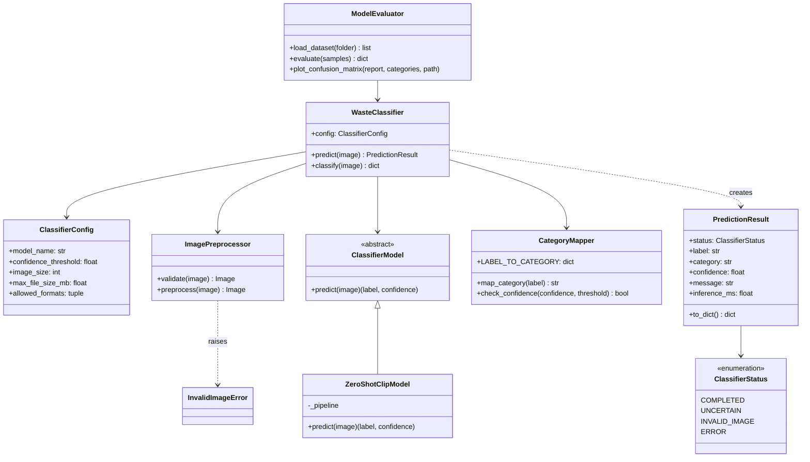

# Subsystem 3 – Computer Vision Classifier Model

**Owner:** Azam Rahmani (ESE, 7224524) · Team 26 · AI-Powered Waste Sorting & Recycling Assistant

The classifier receives one waste-item image from the Flask backend and returns
the item label, waste category (recyclable · compostable · landfill), confidence
and a status. It uses a pretrained CLIP vision model (`openai/clip-vit-base-patch32`)
in zero-shot mode, so no training is needed.

## How the backend uses it

```python
from classifier import WasteClassifier

classifier = WasteClassifier()            # create once at app start
classifier.warm_up()                      # load the model before the first request
result = classifier.classify(request.files["image"].read())
```

The result always contains the same fields:

```json
{"status": "completed", "label": "glass jar", "category": "recyclable",
 "confidence": 0.92, "message": "", "inference_ms": 140.3}
```

| status | meaning | what the web page should show |
|---|---|---|
| `completed` | confident prediction | label, category, bin guidance |
| `uncertain` | confidence below threshold (default 0.5) | the prediction marked as "uncertain" |
| `invalid_image` | empty, corrupt, unsupported or too large file | `message` as an error |
| `error` | model failed | "classifier unavailable" |

`label` is exactly an item label from the Data Management subsystem's
`data/waste_guidance.json` (lowercase with spaces, e.g. `banana peel`), so the
backend can pass it straight to `get_rule(label)`. The category matches that file too.

## Class diagram



## Setup

```bash
python -m venv .venv
.venv\Scripts\activate
pip install -r requirements.txt
```

## Run

```bash
python scripts/classify_image.py photo.jpg        # one image
python scripts/evaluate.py test_images/           # accuracy + confusion matrix
python -m pytest -v                               # unit tests (no model download needed)
```

For `evaluate.py`, put photos in `test_images/<label>/`, using the labels from
`CategoryMapper.LABEL_TO_CATEGORY`, with `_` instead of spaces in folder names
(e.g. `test_images/glass_jar/1.jpg` for the label `glass jar`).
The first real run downloads the CLIP model (about 600 MB).

## Requirements coverage

| Requirement | Where |
|---|---|
| FR1 Accept image from backend | `WasteClassifier.classify` (bytes, path or PIL image) |
| FR2 Check image readable/supported | `ImagePreprocessor.validate` |
| FR3 Preprocess | `ImagePreprocessor.preprocess` |
| FR4 Pretrained model inference | `ZeroShotClipModel` |
| FR5 Most likely label | `ZeroShotClipModel.predict` |
| FR6 Map to category | `CategoryMapper.map_category` |
| FR7 Return confidence | `PredictionResult.confidence` |
| FR8 Flag low confidence | `CategoryMapper.check_confidence` → `uncertain` |
| FR9 Clear status | `ClassifierStatus` |
| FR10 Structured output | `PredictionResult.to_dict` |
| NFR1 Performance | `inference_ms`, `ModelEvaluator` average time |
| NFR2 Reliability | `classify` never raises |
| NFR3 Privacy | images stay in memory, never saved |
| NFR4 Robustness | EXIF rotation, RGB conversion, resize |
| NFR5 Consistency | fixed field names (tested) |
| NFR6 Interoperability | JSON-ready dict for Flask |
| NFR7 Observability | status + message, errors logged |
| NFR8 Accuracy | `scripts/evaluate.py` |
| NFR9 Maintainability | preprocessing, model and mapping in separate classes |
| NFR10 Testability | `tests/` with a fake model |
